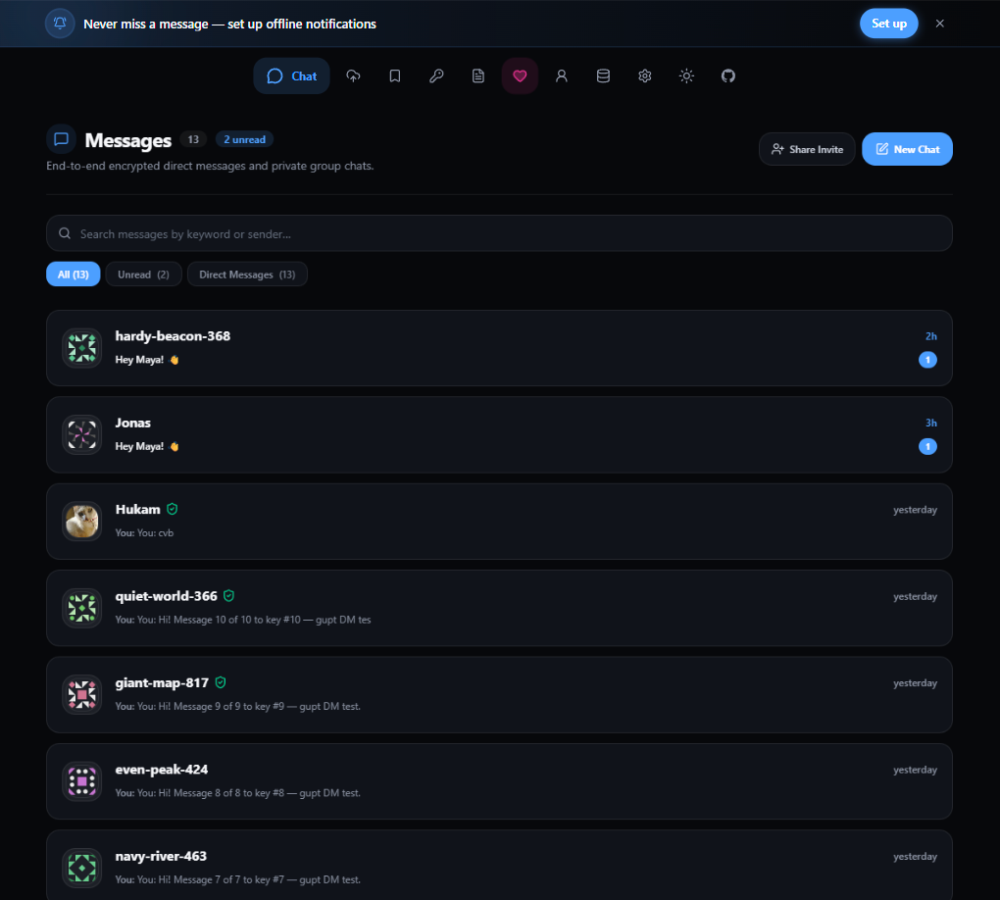
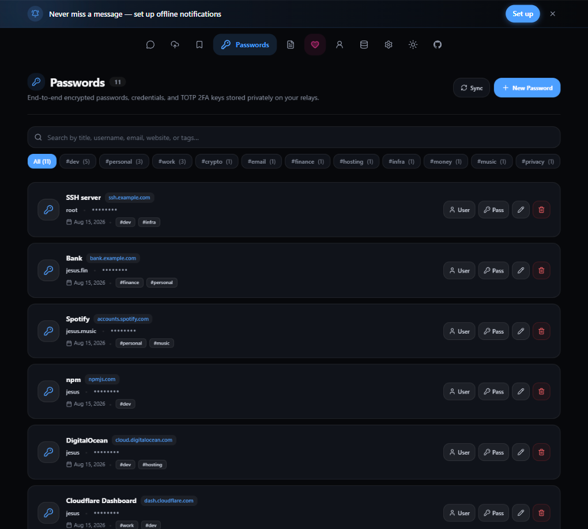
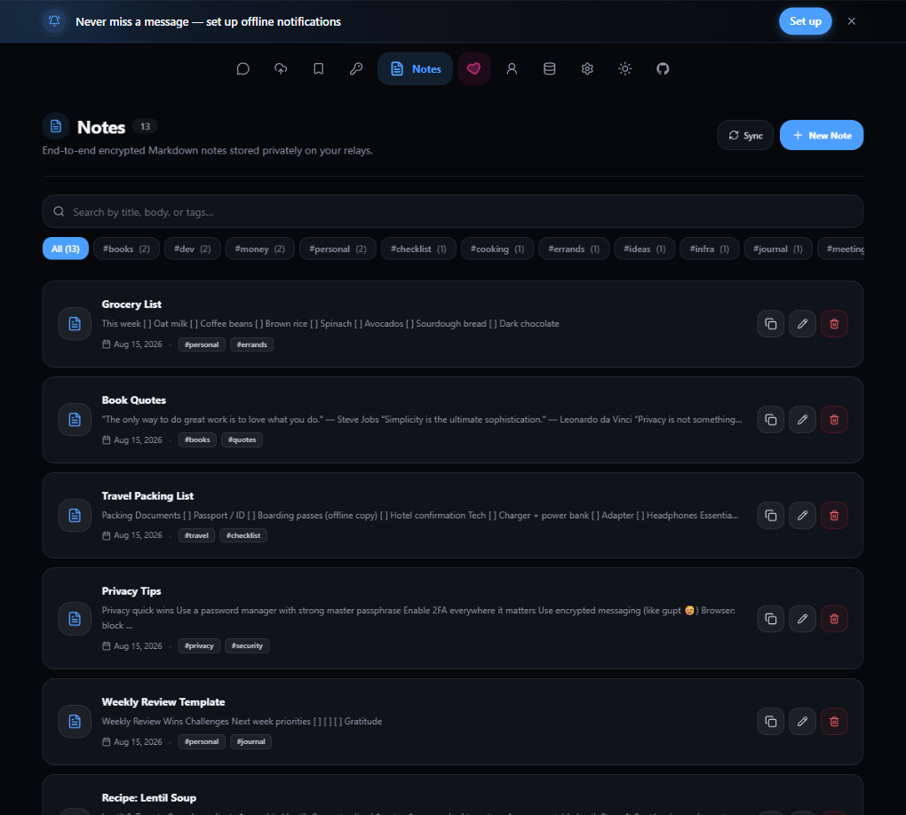
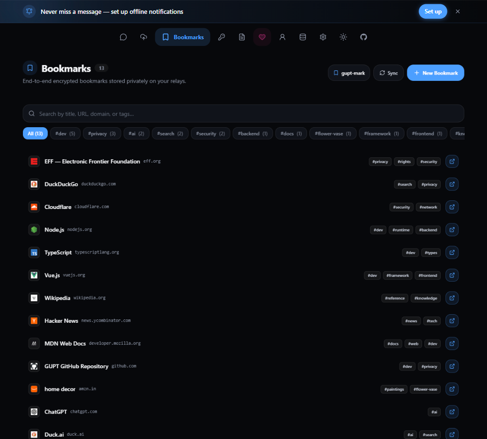
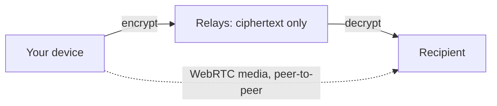

<h1 align="center">GUPT</h1>

<p align="center">
  <strong>Your complete anonymous digital life.</strong><br />
  Encrypted chat & calls, passwords, notes, bookmarks and ephemeral sharing —<br />
  with no phone number, no email and no server account.
</p>

<p align="center">
  <a href="https://gupt.app">Website</a> ·
  <a href="https://github.com/besoeasy/gupt/issues">Issues</a> ·
  <a href="https://github.com/besoeasy/gupt/pkgs/container/gupt">Docker</a> ·
  <a href="./LICENSE">License</a>
</p>

---

## What is GUPT?

GUPT is a privacy suite that runs entirely in your browser. Your identity is a keypair your device derives — no signup, no phone number, no email, no company in the middle.

Messages, calls, files, passwords, notes and bookmarks are encrypted on your device before anything leaves it. The relays that carry them (public or your own) only ever hold ciphertext. That is the whole architecture — and the reason there is no server account to leak, ban or subpoena.

---

## GUPT vs the rest

|                                          | Telegram            | WhatsApp        | Signal      | Discord             | **GUPT**                            |
| ---------------------------------------- | ------------------- | --------------- | ----------- | ------------------- | ----------------------------------- |
| Phone number or email required           | Yes                 | Yes             | Yes         | Yes                 | **No — keypair only**               |
| End-to-end encrypted messages by default | No (opt-in)         | Yes             | Yes         | No                  | **Yes**                             |
| Central server holding your data         | Yes                 | Yes             | Yes         | Yes                 | **No — relays only, self-hostable** |
| Metadata & social graph                  | Visible to operator | Visible to Meta | Partial     | Visible to operator | **Nothing tied to a real identity** |
| Browser-native, nothing to install       | Web client          | Web client      | Desktop app | Web app             | **Yes (PWA)**                       |
| Peer-to-peer voice & video               | No                  | No              | Partly      | No                  | **Yes (WebRTC)**                    |
| Built-in passwords, notes, bookmarks     | No                  | No              | No          | No                  | **Yes, all encrypted**              |
| Open source                              | Clients only        | No              | Yes         | No                  | **Yes, noncommercial**              |
| Account can be banned or suspended       | Yes                 | Yes             | Rare        | Yes                 | **No account to ban**               |

> Telegram encrypts only opt-in "secret chats". Signal's metadata is minimal (sealed sender) but accounts are still phone numbers. GUPT relays see ciphertext and routing metadata — never content.

---

## One year of support

**GUPT never strands an old client.** Every release from now on keeps working with any GUPT build from the previous **400 days**, and with any relay from the same window. If you last opened the app a year ago, or you self-host a build that lags behind, it still connects, decrypts and syncs — nothing to export, nothing to reinstall.

What that means for you:

- **Sign in once a year and you are current.** Come back after months away, enter your secret phrase and PIN, and the app restores everything relays still hold and silently loads the newest build.
- **Your sign-in never goes stale.** The secret phrase and PIN that derive your key are frozen. A phrase written down a year ago opens the app today, unchanged.
- **Nothing is silently cut off.** Newer message formats are read alongside the older ones and only retired after 400 days, so an outdated client or relay shows up as “waiting”, never as empty or corrupted history.
- **Self-hosted relays do not have to chase the web app.** A relay or Docker image up to 400 days old is still supported, and a current relay still serves a 400-day-old client.
- **Your history is bounded by relay retention, not by us.** Events expire after 366 days by design, so a year away restores the last 366 days. That expiry is a privacy feature, not a limit on the promise.

Releases are dated: `2026.1120.1` is the first release of 20 November 2026, and the trailing counter marks further releases that day. Settings shows when the build you are running was made, so you can always tell how old your copy is without digging through release notes.

---

## Screenshots

<p align="center">
  
  &nbsp;
  
</p>
<p align="center">
  
  &nbsp;
  
</p>

---

## Features

### 💬 Chat & messaging

- **1:1 DMs and private groups** — groups hold 2–8 people including you. A group is exactly its sorted member set: no owner, no admin, no mutable roster; changing members creates a new group.
- **Per-member group encryption** — every group message is one self-contained event with an individually sealed copy for each member.
- **Replies** — hover a bubble or swipe it right to quote it; the composer shows the quoted preview.
- **Edits** — edit your own text messages in DMs; the newest edit wins and the bubble is marked “edited”.
- **Reactions** — ❤️ 👍 😂 😮 😢 🔥, one per person per message; tap again to remove.
- **Mentions** — type `@` in a group to pick from up to 5 matching members.
- **Message info** — long-press or right-click for the message/event ID (copyable), delivery state, full timestamp, copy text, seen-by/waiting-on lists, and a link to the event on a relay.
- **Copy and save** — copy text, copy public keys, download attachments, save images, and open shared coordinates in OpenStreetMap.
- **Pinned chats** — pin conversations above the rest; pinned chats are grouped first.
- **Unread badges** — per-chat counts and a total in the sidebar; counts reset when you open the chat.
- **Search** — search message text across conversations with highlighted snippets; last 10 days by default, one tap to search all stored history.
- **Paginated history** — a 25-message window with “load older”, served from the local cache first and then from relays.
- **Conversation polish** — day separators, a “new messages” pill, scroll anchoring, and auto-scroll only when you are already near the bottom.
- **Live conversation telemetry** — a details drawer with last activity, events on relays vs this device, sync parity, relay latency, node ID, and peer bio/website for DMs.
- **Call history in chat** — ended, missed, declined, busy and failed calls render as inline events.

### ✍️ Composer & formatting

- Enter sends; Shift+Enter adds a line; IME candidate confirmation never sends by accident.
- Formatting menu for bold, italic, strike, inline code, lists, quotes, links and link-only `{{button "Label" url}}` buttons, plus a live preview.
- Per-message render mode: **Auto** (format only when a strong construct appears), **Formatted** or **Plain** ([reference](https://gist.githubusercontent.com/besoeasy/098bbed1f63a57a16f208c15155fbf7c/raw/message-format.md)).
- Sender text is parsed into Vue nodes with node and depth caps — never rendered as HTML.
- 8,000-character message limit.
- Keyboard shortcuts: Ctrl/Cmd+B bold, I italic, K link, E inline code.
- Attach images or files, up to 10 per send, with upload progress, retry and cancel.
- Paste an image straight from the clipboard as an attachment.
- Images are re-encoded to JPEG q0.92 before upload; GIF, WebP and AVIF keep their animation.
- Location draft with approximate or precise accuracy, an editable label, and explicit send/cancel.
- Voice notes with a live 24-bar level meter and elapsed timer while recording.
- Reply and edit banners; starting one cancels the other.

### ⏱️ Timers, receipts & presence

- **Per-DM message timer** — 1 minute, 5 minutes, 1 hour, 24 hours, 7 days, 30 days or 366 days (default), minimum 60 seconds. The newest change is shared with the other side.
- Each message stamps its own deadline at send time, so changing the timer never moves messages that were already sent.
- Relays expire events at the deadline and this device deletes its copy; a countdown ring appears in the final 24 hours, with a 10-second warning.
- **Read receipts** — sent/delivered/read ticks, partial-read ticks for groups, and seen-by/waiting-on lists in message info.
- Group receipts are debounced watermarks rather than one event per message; receipts expire after 30 days, so an old message can honestly show “no record”.
- **Last seen** — the latest relay event for a key, fetched with a 4-second timeout and never cached; the header dot is green only for activity within 10 minutes.
- **PING** — wake an offline contact through ntfy without revealing message content (5-minute cooldown).

### 📎 Media & attachments

- AES-GCM encryption per blob; keys travel inside the message event, so relays and blob hosts only ever see ciphertext.
- Files over 2 MB split into up to 8 sealed parts, so every blob fits nodes with small blob size limits.
- Downloads run through a 3-at-a-time queue with de-duplication and priority.
- Preflight probes every part before the full download; missing parts surface an “incomplete upload” state with a per-chunk inspector, copyable hashes and a relay event link.
- SHA-256 verification rejects wrong byte counts and undecodable images before a file enters the decrypt cache.
- Quiet auto-retry every 8 seconds for up to 6 attempts while a failed attachment is visible and online.
- Images, video and audio preview inline; attachment blobs preload within 500 px of the viewport.
- Image lightbox with pinch zoom (0.5–5×), pan, and double-tap to zoom.
- Voice-note playback with a waveform, seek, and 1×/1.5×/2× speed.
- Save to device (Web Share on iOS), with sanitized filenames and MIME-derived extensions.
- Decrypted media cache in IndexedDB, plus a remembered preferred source per attachment.

### 📞 Calls

- Peer-to-peer WebRTC voice, video and screen sharing; media flows directly between devices and relays carry only signaling.
- Calls are DM-only and unlock after you send 7 messages to that contact; an unlock sheet shows the remaining count.
- Incoming calls answer/decline; outgoing calls ring for 45 seconds; call requests expire after 60 seconds.
- Mute, camera on/off, front/back camera switch, screen share with automatic camera restore, and a floating call window when you leave the call route.
- Live call timer plus quality stats: RTT, packet loss, jitter and candidate pair.
- Connectivity precheck warns when there are no ICE candidates or no STUN/relay path.
- Automatic recovery attempts an ICE restart up to twice when the connection drops.
- **SAS verification** — compare 4 emojis and a 4-digit code derived from both SDP fingerprints, then mark the call verified on your device.
- Human-readable media-permission errors and a call-event history in the chat.

### 📰 Feed

- **Global, Trusted and Mine** tabs; Trusted shows posts from contacts you have messaged.
- Text posts up to 2,000 characters with up to 4 attachments (images, video, audio): 100 MB per file, 250 MB total, uploaded 3 at a time.
- Comments up to 500 characters with edit and delete; emoji reactions with one per person per post.
- Post search, 30-post pagination, and long posts collapsing after 420 characters.
- “Expires in …” badges, plus tombstones for deleted posts and comments.
- Attachments stay encrypted; their keys ride in the post event and use the same media pipeline as chat.
- Optimistic reactions and comments appear before relay confirmation.

### 🔐 Passwords

- Encrypted login vault with title, username, email, password, multiple websites, secure notes and tags.
- Client-side search across every field, hostname and tag, with tag chips and counts.
- Built-in generator: 8–64 characters, selectable A-Z/a-z/0-9/symbols, ambiguous characters excluded, regenerating on every change.
- **TOTP 2FA** — Base32 secret validation, live 6-digit code, seconds remaining and one-tap copy.
- Password masking with an eye toggle and one-tap copy for username, email, password and code.
- Delete publishes an encrypted tombstone, so the record cannot return from another relay.
- Entries sync as self-renewing encrypted streams; edits chain to the previous event ID.

### 📝 Notes

- Encrypted plain-text notes with an optional title derived from the first non-empty line.
- A distraction-free editor that keeps line breaks exactly as typed.
- Search across title, body and tags; tag chips with counts.
- Card previews flatten the body to one clean line; one-tap copy of the note text.
- Tombstone deletes and the same self-renewing encrypted stream as Passwords.

### 🔖 Bookmarks & gupt-mark

- Encrypted bookmarks with title, URL, tags, favicon and search across title, URL, domain and tags.
- URLs are normalized: bare hosts get `https://`, hashes and `www.` are dropped, tracking parameters (`utm_*`, fbclid, gclid, …) are stripped, and saving the same URL again updates it instead of duplicating.
- **gupt-mark** bookmarklet saves the page you are on from any browser, asks for optional tags, and takes the title from `og:title`, the document title or the first `h1` — no extension.
- Signed out, gupt-mark queues links in localStorage (up to 50, de-duplicated). The next signed-in Bookmarks visit publishes them and reports how many were imported:

```
Signed out: gupt-mark ──▶ offline queue (localStorage on your device)
Signed in:  Bookmarks view ──▶ queue drains ──▶ encrypted, published to relays
```

- A public hotlink page handles the bookmarklet tab, waits for identity, shows a 3-second countdown with Save now/Cancel, then lands on Bookmarks.
- Delete with tombstone; 366-day live stream with automatic renewal.

### 🎟️ Invites & discovery

- Start a DM from a 64-character public key, a domain name, or a pasted match-lobby code.
- **Temporary invites** disguise themselves as game lobbies: `match:lobby:…`, a decoy gamertag, copy as a full game invite or raw code, and expiry from 1 hour to 30 days.
- **Permanent profile ID** — your public key works forever, needs no stored invite record, and can be shared in bios or on websites.
- **Domain contact** — publish a `gupt.<domain>` TXT record (bare key, or `v=gupt1 k=… r=…` with a relay hint) and people can reach you by domain name.
- Domain lookup uses Cloudflare, Google and Quad9 DoH, honours the record TTL with a stale fallback during outages, reports DNSSEC validation, and pins the first key it sees so a later change is flagged.
- Create groups from trusted contacts, with a fixed membership cap of 8 including you.

### 🪪 Identity & sign-in

- No signup, no email, no phone — an Ed25519 keypair derived on your device.
- **Two reproducible sign-in paths**, both requiring a PIN of at least 6 letters or digits:

| Way                                | You provide                                                                                   |
| ---------------------------------- | --------------------------------------------------------------------------------------------- |
| **Paste a secret** — recommended   | Any text: passphrase, sentence, crypto seed, wallet mnemonic                                  |
| **Use a secret file** — two-factor | A photo or keepsake only you have; hashed locally with SHA-256 (up to 100 MB), never uploaded |

- The PIN is mixed with the secret (or the file hash) before a single Argon2id pass (t=4, 64 MiB, p=1), so a leaked secret or copied file alone is not enough.
- PIN strength and entropy hints while choosing; there is no recovery if both are forgotten — that is the point.
- **Stay signed in on this device** — over HTTPS the key is wrapped by a non-extractable browser key in IndexedDB (`gupt_vault_v1`), so a relaunch or a new tab opens straight into the chat with nothing typed. The wrapper key's bytes can never be read by JavaScript. You pick the inactivity window when you sign in, from 5 minutes to 3 days (30 hours by default); the vault is deleted when it runs out, on logout, or from **Me → Forget this device**. It is never synced; recovery is always the secret (or file) plus PIN.
- **Plain HTTP has no persistence** — `crypto.subtle` does not exist in an insecure context, so nothing is stored and every load is a normal sign-in. Serve gupt over TLS.
- Account switcher, plus a logout that wipes the local cache, localStorage and the remembered device.
- Profile fields: display name, about, website and a 150-character status, with copyable public key and profile link.
- Deterministic generated avatars — no photo is required.

### 👤 Profiles & public pages

- Public profile pages at `/profile/<pubkey>` with avatar, name, status, bio, website, last seen and a Send Message action.
- Copy your public key or profile link from **Me** in one tap, with a copied confirmation.
- Profiles resolve locally first, then refresh from relays in the background; missing profiles fall back to a short key.
- Anyone can read a public profile — only starting a chat needs an account.

### 🤖 Bots

- **Bot directory** built from signed `gupt/bot/beacon` heartbeats; only beacons from the last 60 minutes are listed, newest per public key ([protocol](https://gist.githubusercontent.com/besoeasy/098bbed1f63a57a16f208c15155fbf7c/raw/bots.md)).
- One card per bot key with name, owner, description, website, short key and beacon age.
- A 30-day local “known since” ledger adds a `30d+` badge that relays cannot spoof — no central registry, no server-side moderation, no bought badges.
- Filters **All / Established / New**, search across name, description, owner and website host; established bots sort first.
- Auto-refresh every 60 seconds while the tab is visible, plus refresh on returning to the tab.
- Clicking a card opens a normal encrypted DM with the bot.
- **Reference publisher** — [gupt-bot-beacon.mjs](https://gist.githubusercontent.com/besoeasy/098bbed1f63a57a16f208c15155fbf7c/raw/gupt-bot-beacon.mjs) signs, publishes and re-announces a bot on a schedule.
- **Reference two-way bot** — [`t3nklabs/gupt-bots`](https://github.com/t3nklabs/gupt-bots) polls DMs, decrypts them, replies and publishes its own beacon.
- **Programmatic guide** — send, receive, poll, and upload chunked attachments from any language in [programmatic-chat.md](https://gist.githubusercontent.com/besoeasy/098bbed1f63a57a16f208c15155fbf7c/raw/programmatic-chat.md).

### 🔔 Notifications & PING

- **PING** is DM-only: it posts `Hey its <name> — come online on gupt.app` to `ntfy.sh/<peer pubkey>`, shows a 3-second confirmation and enforces a 5-minute cooldown. No message content leaves the encrypted chat.
- Notifications setup page with iOS, Android and web ntfy links; subscribe to a topic named after your public key — no email or phone required.
- **Encrypted notifications** — CI, backups and agents can DM your pubkey and the payload stays ciphertext, an ntfy replacement. The Integrations page hands your agent a notifier prompt, prefilled with your key, that reads this repo and builds it.
- In-app message sound (a synthesized WebAudio ping) with a Settings toggle.
- No central push service holds your account or message content — ntfy carries only the wake-up nudge.

### 🧩 Integrations

- Integrations index for gupt-mark, ntfy and a self-hosted backup node.
- Two AI-agent starting points: the [`t3nklabs/gupt-bots`](https://github.com/t3nklabs/gupt-bots) Docker template, and a copyable notifier prompt that reads this repo and DMs your prefilled public key.
- **Programmatic Chat API** — complete protocol guide for bots, scripts, automated alerts and two-way listeners ([reference](https://gist.githubusercontent.com/besoeasy/098bbed1f63a57a16f208c15155fbf7c/raw/programmatic-chat.md)).
- gupt-sdk bot framework and the published bot protocol.

### 🌐 Relays & network

- Default public relay mesh, with add/remove custom relays, probe all, reset to defaults, and configured/active counts.
- **Health scoring** from real sends and queries over a 90-day window: champion/good/degraded/poor/offline tiers, latency, combined relay score, battery and quota states.
- Relay selection ranks the best-performing nodes first and reserves a share of traffic for untested ones, so a new node can earn its place.
- Automatic failover and multi-mirror reads keep a send alive when one relay is down.
- **Relay mesh sync dashboard** — an independent worker replicates events and blobs between all configured Rabta servers: 50-unit budget per run (text = 1, blob = 10), random 10–30 second waits, pause/resume, consistency %, bisection probe stats, quota-protected blobs, HTTP Range resume and a live log.
- Per-conversation relay telemetry, and a link from any DM event to its relay record.
- Self-host your own relay for durability; the app treats it like any other node.

### 💾 Offline storage & PWA

- **Local-first** — rooms, groups, profiles, events, blobs and decrypted media live in IndexedDB, so the app opens and scrolls offline.
- 300 MB shared LRU budget across media and blobs; cache entries expire with retention (366 days) and are purged on a timer.
- Long message text is gzip-compressed in the cache when it is at least 512 characters.
- Unsent self-authored events wait in a localStorage outbox (200 entries / 1 MB) and are retried; the cache is disposable and relays remain the source of truth.
- Installable PWA with standalone display; a new service worker resets disposable state and reloads cleanly.
- Native Linux app (Flatpak), with keyboard, mouse and touch support down to 360 px.
- Dark and light themes with an animated switch, and subtle haptics on send, copy, swipe and errors.

### ⚙️ Settings, sync & stats

- **Settings** — notification sound, sync status, relay health, and the build date.
- **Sync panel** — idle/active/paused state, the last five relay ticks, a relay-copy durability check (events checked / missing), and Sync now or Retry.
- **Relay panel** — status dots, tier, latency, score, battery/quota warnings, remove, probe and reset.
- **Stats** — cache usage per store, relay ranking (EWMA) and relay health from real outcomes, over a 90-day rolling window.

### 🛟 Backup, sync & self-hosting

- The browser already keeps a 1:1 copy of your account; a backup node adds an off-device copy.
- **One-command Docker/Podman backup node** with a storage pin (off, 5, 20 or 50 GB), restart policy, named volume, and a policy that gives records owned by your key priority.
- “Copy command” builds the exact command from your public key, with a hint for exposing the port when you need remote writes.
- Relay-mesh replication and durability checks show whether your events exist beyond this device.
- Self-host a relay for durable streams — streams outlive most public relay retention.

### ❤️ Support

- Donate page with a monthly sats goal (1,250,000 sats), animated progress and a live BTC/USD estimate when a price feed answers.
- Bitcoin QR, select-all address, copy address and an Open Wallet link.
- GitHub Sponsors card marked recommended.
- Donate appears in the navbar after a short delay.

---

## Get started

| I want to…            | Use                                                                                                                                                                                                                                                                                                                                                      |
| --------------------- | -------------------------------------------------------------------------------------------------------------------------------------------------------------------------------------------------------------------------------------------------------------------------------------------------------------------------------------------------------- |
| Just try it           | 👉 [gupt.app](https://gupt.app)                                                                                                                                                                                                                                                                                                                          |
| Run it locally        | `npx github:besoeasy/gupt`                                                                                                                                                                                                                                                                                                                               |
| Self-host with Docker | `docker run -p 8000:8000 ghcr.io/besoeasy/gupt:latest`                                                                                                                                                                                                                                                                                                   |
| Native Linux app      | `flatpak install flathub com.besoeasy.gupt`                                                                                                                                                                                                                                                                                                              |
| Deploy my own URL     | [Vercel](https://vercel.com/new/clone?repository-url=https://github.com/besoeasy/gupt) · [Netlify](https://app.netlify.com/start/deploy?repository=https://github.com/besoeasy/gupt) · [Railway](https://railway.com/new/template?template=https://github.com/besoeasy/gupt) · [Render](https://render.com/deploy?repo=https://github.com/besoeasy/gupt) |
| Home server (Umbrel)  | [Umbrel App Store](https://apps.umbrel.com/app/gupt) — one click                                                                                                                                                                                                                                                                                         |
| Build from source     | `git clone … && npm install && npm run dev` (Node ≥ 24)                                                                                                                                                                                                                                                                                                  |

> **Self-hosting tip:** run at least one relay yourself — GUPT's streams live longer than most public relays retain events, and your relay keeps them durable.

---

## How it works



1. **Identity** — a keypair is derived on your device and never leaves it.
2. **Everything else** — encrypted locally, published to relays, synced back on any device with the same sign-in.
3. **Calls** — WebRTC media goes directly between devices; relays carry only signaling.

---

## Star History

[](https://www.star-history.com/?repos=besoeasy%2Fgupt&type=date&legend=top-left)

## Tech & license

Vue 3 · Pinia · Vite · Tailwind CSS · Dexie · Noble crypto · Originless · WebRTC

[CC BY-NC 4.0](./LICENSE) — attribution required, commercial use prohibited.
