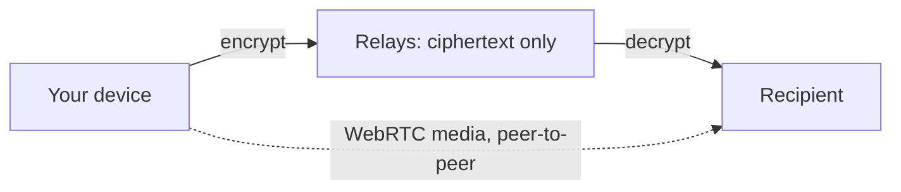

<h1 align="center">GUPT</h1>

  <strong>Your complete anonymous digital life.</strong> 
  Encrypted chat & calls, passwords, notes, bookmarks and ephemeral sharing — 
  with no phone number, no email and no server account.

  
  
  

  <a href="https://gupt.app">Website</a> ·
  <a href="https://github.com/besoeasy/gupt/issues">Issues</a> ·
  <a href="https://github.com/besoeasy/gupt/pkgs/container/gupt">Docker</a> ·
  <a href="./LICENSE">License</a>

---

## What is GUPT?

GUPT is a privacy suite that runs entirely in your browser. Your identity is a keypair your device derives — no signup, no phone number, no email, no company in the middle.

Messages, calls, files, passwords, notes and bookmarks are encrypted on your device before anything leaves it. The relays that carry them (public or your own) only ever hold ciphertext. That is the whole architecture — and the reason there is no server account to leak, ban or subpoena.

---

## GUPT vs the rest

| | Telegram | WhatsApp | Signal | Discord | **GUPT** |
| --- | --- | --- | --- | --- | --- |
| Phone number or email required | Yes | Yes | Yes | Yes | **No — keypair only** |
| End-to-end encrypted messages by default | No (opt-in) | Yes | Yes | No | **Yes** |
| Central server holding your data | Yes | Yes | Yes | Yes | **No — relays only, self-hostable** |
| Metadata & social graph | Visible to operator | Visible to Meta | Partial | Visible to operator | **Nothing tied to a real identity** |
| Browser-native, nothing to install | Web client | Web client | Desktop app | Web app | **Yes (PWA)** |
| Peer-to-peer voice & video | No | No | Partly | No | **Yes (WebRTC)** |
| Built-in passwords, notes, bookmarks | No | No | No | No | **Yes, all encrypted** |
| Open source | Clients only | No | Yes | No | **Yes, noncommercial** |
| Account can be banned or suspended | Yes | Yes | Rare | Yes | **No account to ban** |

> Telegram encrypts only opt-in "secret chats". Signal's metadata is minimal (sealed sender) but accounts are still phone numbers. GUPT relays see ciphertext and routing metadata — never content.

---

## Screenshots

  
  &nbsp;
  

---

## Features

### 💬 Chat

- End-to-end encrypted DMs and group chats with admin roles
- Replies, edits, reactions, emoji and @mentions
- Typing indicators, paginated history, in-chat search
- Encrypted voice messages
- **Feed** — posts with comments and emoji reactions, global or contacts-only
- **Location sharing** — coordinates inside the encrypted payload; approximate by default, no tile server or geocoder contacted

### 📞 Calls

- Peer-to-peer WebRTC voice, video and screen sharing
- Media flows directly between devices; relays carry only signaling
- Trusted-contact guard (`sentCount >= 7`) keeps strangers from ringing you

### 🖼️ Media

- Images, video and audio encrypted (AES-GCM) before upload
- Stateless Originless blob storage; multi-mirror download with SHA-256 verification

### 🔐 Privacy tools

| Tool          | What it is                                                     |
| ------------- | -------------------------------------------------------------- |
| **Passwords** | Logins with TOTP / 2FA codes, multi-URL sites and tags         |
| **Notes**     | Encrypted Markdown with tags and search                        |
| **Bookmarks** | One-click page saving with the gupt-mark bookmarklet           |
| **Share**     | Ephemeral encrypted links anyone can open — no account needed  |

Passwords, Notes and Bookmarks sync across devices as self-renewing ciphertext streams with tombstone deletes.

### 🪪 Identity

- No signup flow — a keypair is derived on your device, hardened with Argon2id
- **Three ways to sign in**, each reproducible on any device:

| Way                             | You provide                                                        |
| ------------------------------- | ------------------------------------------------------------------ |
| **Memory anchors** — recommended | 2–7 answers: passphrase, PIN, date, person, country, pet, car     |
| **Paste a secret** — advanced    | Any text: passphrase, PIN, sentence, crypto seed, wallet mnemonic |
| **Secret file** — advanced       | A photo or keepsake only you have; read locally, never uploaded   |

- **Relay invite links** — one link carries your public key and relay set
- **Domain contact** — publish a `gupt.` TXT record and people can reach you by domain name
- Deterministic avatars — a profile photo is optional

### 🔔 Notifications

- **PING** — wake an offline contact through a public ntfy topic named after their key
- **Encrypted notifications** — CI, backups and agents can DM your pubkey; the payload is ciphertext (an ntfy replacement)

### 🌐 Network & storage

- Public relay network with health scoring and automatic failover — run your own relay for durability
- Full offline cache in IndexedDB, purged automatically
- Installable PWA, native Linux app (Flatpak), dark & light themes

---

## Get started

| I want to…             | Use                                                                 |
| ---------------------- | ------------------------------------------------------------------- |
| Just try it            | 👉 [gupt.app](https://gupt.app)                                     |
| Run it locally         | `npx github:besoeasy/gupt`                                          |
| Self-host with Docker  | `docker run -p 8000:8000 ghcr.io/besoeasy/gupt:latest`              |
| Native Linux app       | `flatpak install flathub com.besoeasy.gupt`                         |
| Deploy my own URL      | [Vercel](https://vercel.com/new/clone?repository-url=https://github.com/besoeasy/gupt) · [Netlify](https://app.netlify.com/start/deploy?repository=https://github.com/besoeasy/gupt) · [Railway](https://railway.com/new/template?template=https://github.com/besoeasy/gupt) · [Render](https://render.com/deploy?repo=https://github.com/besoeasy/gupt) |
| Home server (Umbrel)   | [Umbrel App Store](https://apps.umbrel.com/app/gupt) — one click     |
| Build from source      | `git clone … && npm install && npm run dev` (Node ≥ 24)             |

> **Self-hosting tip:** run at least one relay yourself — GUPT's streams live longer than most public relays retain events, and your relay keeps them durable.

---

## How it works

1. **Identity** — a keypair is derived on your device and never leaves it.
2. **Everything else** — encrypted locally, published to relays, synced back on any device with the same sign-in.
3. **Calls** — WebRTC media goes directly between devices; relays carry only signaling.

---

## Tech & license

Vue 3 · Pinia · Vite · Tailwind CSS · Dexie · Noble crypto · Originless · WebRTC

[CC BY-NC 4.0](./LICENSE) — attribution required, commercial use prohibited.
